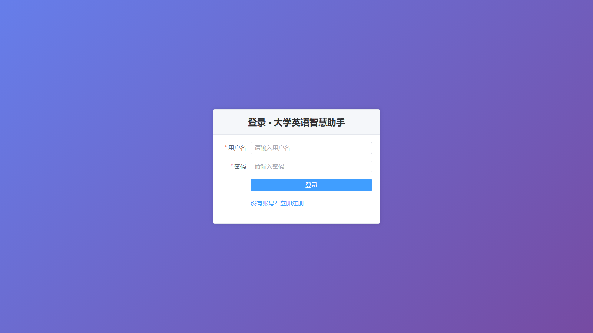
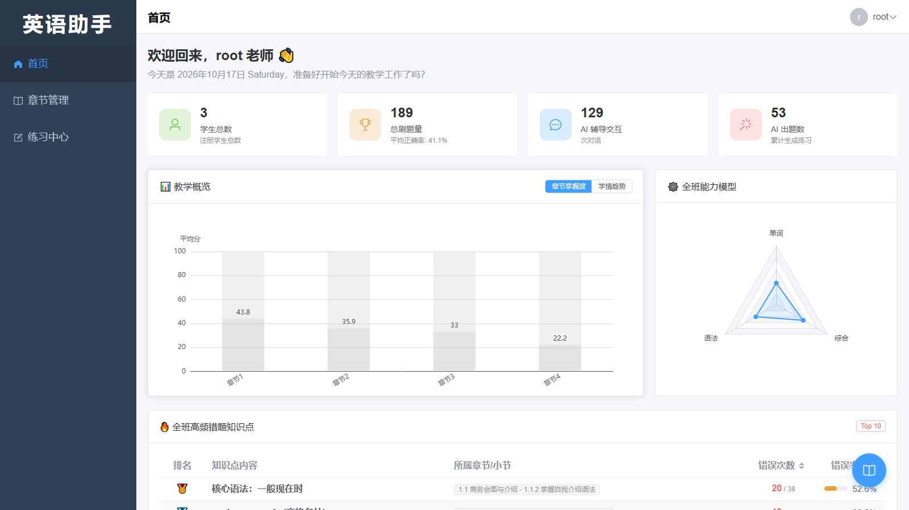
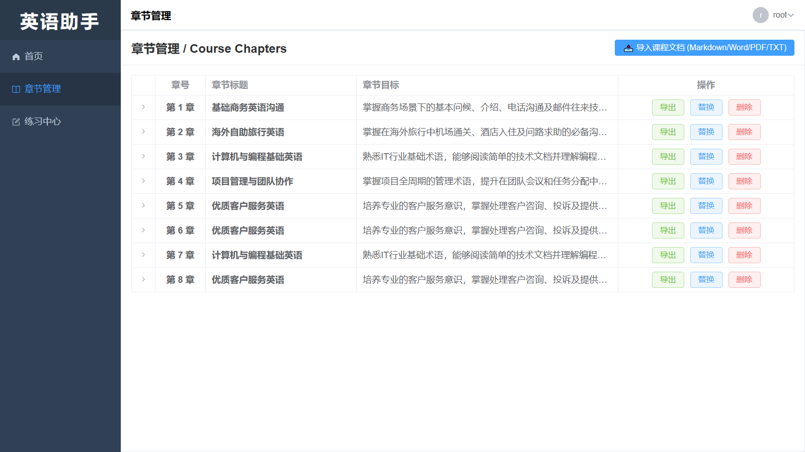
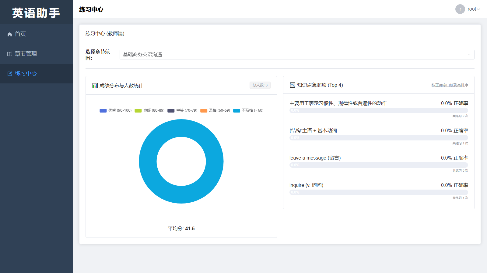
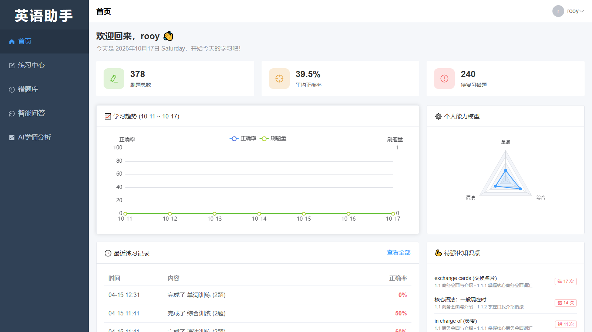
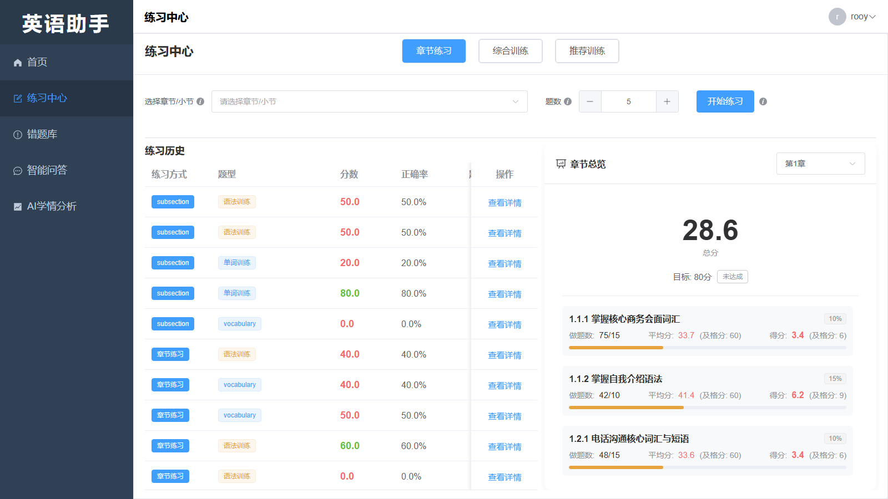
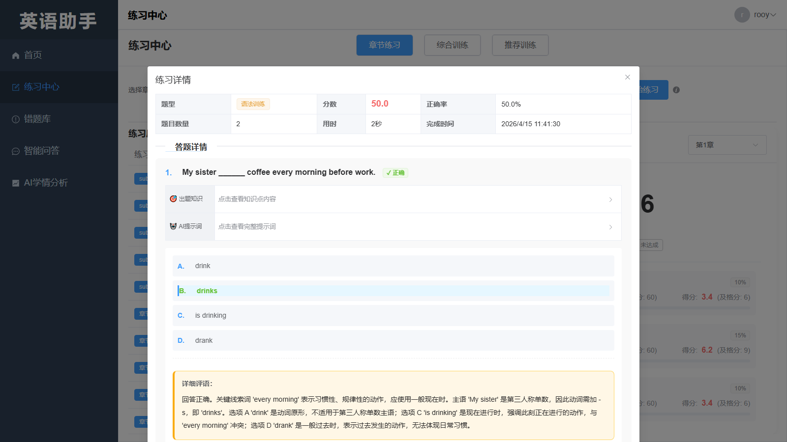
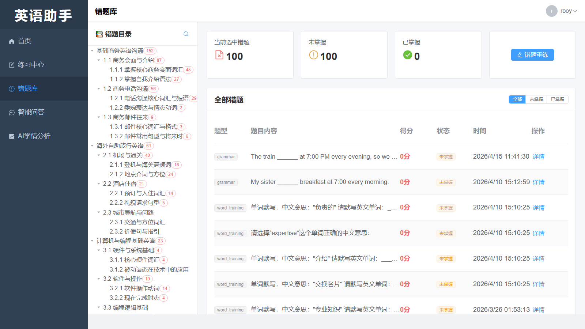
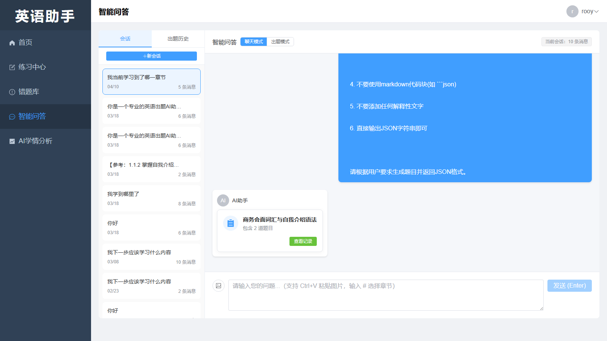
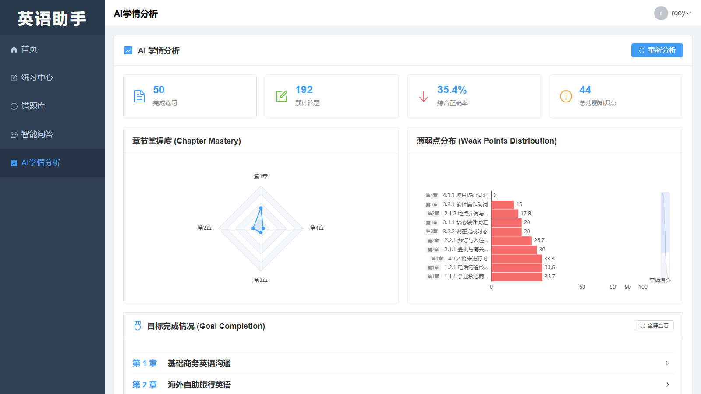

# 大学英语智慧助手 (College English Assistant)

> 一个基于 **RAG + LLM + MCP** 的大学英语教学辅助平台：教师按「章 - 节 - 小目标」三级体系上传教案，AI 自动出题与判分；学生练习、错题复习、智能问答，并获得数据可视化的学情诊断报告。

<p align="left">
  
  
  
  
</p>

> 下文所有界面截图均来自真实运行的系统（连接 MySQL 数据库、前后端已启动）。

---

## 目录

- [项目简介](#项目简介)
- [界面预览](#界面预览)
- [核心功能](#核心功能)
- [技术栈](#技术栈)
- [系统架构](#系统架构)
- [数据库设计](#数据库设计)
- [项目结构](#项目结构)
- [快速开始](#快速开始)
- [API 概览](#api-概览)
- [文档索引](#文档索引)

---

## 项目简介

传统英语教学的线上作业模式存在三个痛点：**反馈只有一个分数，没有解析**、**题目数量有限且重复**、**做题数据彼此孤立无法形成学情诊断**。

本项目把「练习 → 反馈 → 修正」这一闭环补齐：

1. **目标导向的知识体系**：教师上传的教案被解析为 `章(Chapter) → 节(Section) → 小目标(SubSection)` 三级结构，每个小目标都有独立的**权重占比、合格分数、最少题数**。
2. **分章节 RAG 知识库**：教案（Markdown / Word / PDF / TXT）经解析、分块、向量化后写入 ChromaDB，检索时按章节隔离，出题与问答都可溯源到具体小节。
3. **AI 出题与判分**：LLM 依据小目标的内容与规则生成题目，提交后自动判分并给出**逐题的详细评语与解题思路**。
4. **MCP 数据桥梁**：通过独立的 MCP Server（Model Context Protocol）把数据库中的做题记录、正确率、错题分布等原始数据无损地交给大模型，用于生成个性化复习建议与针对性出题。
5. **可视化 + 自适应**：教师端与学生端均提供能力雷达、成绩分布、薄弱知识点排行等图表；AI 学情分析会自动生成薄弱点报告与复习目标进度。

---

## 界面预览

### 登录 / 注册



支持学生与教师两种角色注册，登录后基于 JWT 令牌维持会话，路由守卫按角色动态渲染菜单。

---

### 教师端

#### 1. 教师工作台



统计学生总数、总刷题量、AI 辅导交互次数、AI 出题数；提供**教学概览**（各章节平均分对比）、**全班能力模型**（单词 / 语法 / 综合雷达图）与**全班高频错题知识点排行**。

#### 2. 章节管理（三级知识体系）



以「章 → 节 → 小目标」树形结构管理课程内容，支持 Markdown / Word / PDF / TXT 教案导入、导出，以及章节替换与删除。

#### 3. 练习中心（教师视角）



按章节查看全班**成绩分布与人数统计**（优秀 / 良好 / 中等 / 及格 / 不及格），以及**知识点薄弱项 Top 4** 排行，快速定位需要重点讲解的知识点。

---

### 学生端

#### 4. 学生首页



展示刷题总数、平均正确率、待复习错题数与**学习趋势**（正确率 / 刷题量双轴折线）；**个人能力模型**雷达图、最近练习记录、待强化知识点一目了然。

#### 5. 练习中心（学生视角）



支持**章节练习 / 综合训练 / 推荐训练**三种模式，可自选章节与小目标、设置题目数量；右侧**章节总览**实时显示目标达成度与每个小目标的得分明细（如 `1.1.1 掌握核心商务会面词汇` 的做题数、平均分、得分）。

#### 6. 练习详情与答案解析



提交后逐题展示作答结果、正确答案、**出题知识来源**、**AI 提示词**以及完整的**详细评语**（讲解语法点与错误原因）。

#### 7. 错题库



按三级知识目录自动归类错题，可切换「全部 / 未掌握 / 已掌握」，显示每道错题的题型、得分与时间；支持**错题重练**与生成同类题。

#### 8. 智能问答



基于 RAG 的多轮对话：可选择关联章节进行检索增强问答，支持**会话管理**（历史会话、新建会话、会话列表），并可在「聊天模式 / 出题模式」之间切换，直接在对话中生成题目。

#### 9. AI 学情分析



自动汇总练习记录，输出**章节掌握度**雷达图、**薄弱点分布**条形图（按平均得分排名）以及**目标完成情况**（按章节下钻到小目标的达成进度），并给出后续复习建议。

---

## 核心功能

| 模块 | 角色 | 能力 |
| --- | --- | --- |
| 用户认证 | 通用 | 注册（教师 / 学生）、登录、JWT 令牌刷新、按角色路由守卫 |
| 章节管理 | 教师 | 三级知识体系（章-节-小目标）维护、教案导入解析、章节导出 |
| 文档管理 | 教师 | PDF / DOCX / TXT 上传、正文抽取、向量化入库、索引重建与清理 |
| 出题与判分 | 学生 | 章节练习、综合训练、推荐训练、单词训练、按小目标定向出题 |
| 错题复习 | 学生 | 错题自动归档、按知识点归类、重练、生成同类题 |
| 智能问答 | 学生 | 分章节 RAG 检索增强问答、多轮对话、会话管理、对话内出题 |
| 学情分析 | 双方 | 能力雷达、趋势曲线、薄弱点排行、目标达成进度、AI 复习建议 |
| 数据统计 | 教师 | 班级成绩分布、知识点薄弱项排行、高频错题统计 |

---

## 技术栈

### 前端

| 技术 | 版本 | 用途 |
| --- | --- | --- |
| Vue | 3.4 | 渐进式框架（Composition API） |
| TypeScript | 5.3 | 类型安全 |
| Vite | 5.0 | 构建与开发服务器 |
| Element Plus | 2.13 | UI 组件库 |
| Pinia | 2.1 | 状态管理（用户 / 章节） |
| Vue Router | 4.2 | 路由与角色守卫 |
| Axios | 1.6 | HTTP 客户端（统一拦截器与错误处理） |
| ECharts | 6.0 | 能力雷达、趋势折线、分布条形图等可视化 |
| marked / dayjs | - | Markdown 渲染 / 日期处理 |

### 后端

| 技术 | 版本 | 用途 |
| --- | --- | --- |
| Python | 3.11 | 运行环境 |
| FastAPI | 0.115 | Web 框架（自动生成 OpenAPI 文档） |
| Uvicorn | 0.32 | ASGI 服务器 |
| SQLAlchemy | 2.0 | ORM |
| Alembic | 1.14 | 数据库迁移 |
| PyMySQL | 1.1 | MySQL 驱动 |
| Pydantic | 2.10 | 数据校验与配置管理 |
| python-jose / passlib | - | JWT 签发与 bcrypt 密码哈希 |

### AI 与检索

| 技术 | 版本 | 用途 |
| --- | --- | --- |
| OpenAI SDK | 1.57 | 调用兼容 OpenAI 协议的 LLM / Embedding 接口 |
| ChromaDB | 0.5 | 向量数据库（分章节知识库持久化） |
| LangChain | 0.3 | 文本切分与检索组件 |
| MCP | - | 独立进程的工具服务（数据搬运工），通过 HTTP/协议与主应用通信 |
| pypdf / python-docx | - | 教案文档正文抽取 |

### 存储与基础设施

| 技术 | 版本 | 用途 |
| --- | --- | --- |
| MySQL | 8.0 | 业务数据（章节、练习、错题、统计等） |
| ChromaDB (本地持久化) | - | 教案向量索引 |
| JWT | HS256 | 无状态鉴权 |

> **AI 服务说明**：项目通过 OpenAI 兼容协议访问大模型与 Embedding 服务，只需在 `.env` 中配置 `LLM_BASE_URL` / `EMBEDDING_BASE_URL` 与对应 API Key，即可对接任意兼容服务（如 DeepSeek、通义千问、本地推理服务等）。

---

## 系统架构

```
┌──────────────────────────────────────────────────────────────────┐
│                       前端 Vue 3 + Element Plus                   │
│   登录 / 教师工作台 / 章节管理 / 练习中心 / 错题库 / 问答 / 学情分析   │
└───────────────────────────┬──────────────────────────────────────┘
                            │ HTTP (Axios, JWT Bearer)
                            ▼
┌──────────────────────────────────────────────────────────────────┐
│                       后端 FastAPI (app/)                         │
│  API 层 (api/v1)  →  服务层 (services)  →  数据访问层 (models)      │
│                                                                   │
│  ┌────────────┐  ┌────────────┐  ┌─────────────┐  ┌───────────┐  │
│  │ 编排 Orche-│  │ RAG 服务   │  │ 出题/判分    │  │ 学情分析   │  │
│  │ strator    │  │ (ChromaDB) │  │ QuizService │  │ AI Analysis│  │
│  └─────┬──────┘  └────────────┘  └─────────────┘  └───────────┘  │
└────────┼──────────────────────────────────────────────────────────┘
         │  两种启动模式（代码完全隔离）
         │  ┌──────────────────────┐   ┌───────────────────────────┐
         └─►│ 默认模式：本地函数调用 │   │ MCP 模式：MCP Server 进程  │
            │ app/tools/            │   │ mcp_server/  (工具服务)   │
            └──────────────────────┘   └───────────────────────────┘
                            │
        ┌───────────────────┼────────────────────┐
        ▼                   ▼                    ▼
   ┌─────────┐       ┌────────────┐      ┌──────────────┐
   │ MySQL   │       │ ChromaDB   │      │ LLM / Embed  │
   │ 业务数据 │       │ 向量索引    │      │ API (OpenAI) │
   └─────────┘       └────────────┘      └──────────────┘
```

**两种启动模式**（无需改动任何代码）：

- **默认模式**：`python -m app.main`，使用 `app/tools/` 中的本地工具函数，性能最优，适合开发调试。
- **MCP 模式**：`python -m app.main mcp`，使用 `mcp_server/` 提供的 MCP 工具服务，通过协议调用，体现 MCP 架构设计。

---

## 数据库设计

核心表结构（完整 DDL 见 [`database/schema.sql`](database/schema.sql)）：

| 表名 | 说明 |
| --- | --- |
| `users` | 用户（教师 / 学生），bcrypt 密码哈希、角色、启用状态 |
| `chapters` | 章（编号、标题、描述、难度、词汇量） |
| `sections` | 节（隶属章） |
| `subsections` | 小目标（隶属节，含权重占比、合格分、最少题数） |
| `knowledge_points` | 知识点（单词 / 语法 / 综合，隶属小目标） |
| `course_documents` | 上传的教案文档（正文、向量化状态、文本块数量） |
| `quiz_records` | 练习记录（题目 JSON、用户答案、得分、正确率、用时） |
| `custom_quiz_records` | 综合训练 / 自定义出题记录 |
| `wrong_questions` | 错题（题型、题干、正确答案、掌握状态） |
| `chat_histories` | 问答会话与消息（含出题模式消息） |
| `user_word_stats` / `user_knowledge_stats` | 单词、知识点维度的累计统计（用于雷达图与薄弱点分析） |

---

## 项目结构

```
bishi/
├── backend/                      # 后端（FastAPI）
│   ├── app/
│   │   ├── api/v1/               # 接口层：auth / chapters / documents / quiz / chat / wrong_question / ai_analysis
│   │   ├── core/                 # 配置、数据库连接、安全（JWT、密码哈希）
│   │   ├── models/               # SQLAlchemy ORM 模型
│   │   ├── schemas/              # Pydantic 请求/响应模型
│   │   ├── services/             # 业务服务：RAG、出题、判分、学情分析、课程解析、编排器、MCP 服务
│   │   ├── tools/                # 默认模式下的本地工具函数
│   │   └── main.py               # 应用入口
│   ├── mcp_server/               # MCP 工具服务（独立进程）
│   ├── migrations/               # Alembic 数据库迁移
│   ├── data_access/              # 数据访问层
│   ├── config.yaml               # 业务配置（分块、检索、出题参数等）
│   ├── requirements.txt          # Python 依赖
│   └── .env.example              # 环境变量模板
├── frontend/                     # 前端（Vue 3 + TypeScript + Vite）
│   ├── src/
│   │   ├── api/                  # 接口封装
│   │   ├── stores/               # Pinia 状态
│   │   ├── router/               # 路由与角色守卫
│   │   ├── layout/               # 主布局
│   │   ├── views/                # 页面：登录、首页（教师/学生）、章节、练习、错题、问答、学情分析
│   │   ├── types/                # TypeScript 类型定义
│   │   └── utils/request.ts      # Axios 实例与拦截器
│   ├── package.json
│   └── vite.config.ts            # 含 /api 与 /static 代理到后端 8000 端口
├── database/schema.sql           # 数据库建表脚本（仅结构，不含业务数据）
├── docs/
│   ├── screenshots/              # README 使用的界面截图
│   ├── dev-notes/                # MCP 实现、启动模式、联调记录等开发笔记
│   ├── prompts/                  # 出题与综合出题提示词
│   ├── 需求规格说明书.md
│   ├── 系统设计说明书.md
│   ├── 详细设计说明书.md
│   ├── 开发文档.md
│   └── ...
└── samples/                      # 可导入的示例教案与模板（Markdown / Word / PDF）
```

---

## 快速开始

### 1. 环境要求

- Python 3.11+
- Node.js 18+（推荐 LTS）
- MySQL 8.0+
- 一个兼容 OpenAI 协议的大模型接口与 Embedding 接口（API Key）

### 2. 初始化数据库

```bash
mysql -u root -p -e "CREATE DATABASE college_english_assistant CHARACTER SET utf8mb4 COLLATE utf8mb4_unicode_ci;"
mysql -u root -p college_english_assistant < database/schema.sql
```

### 3. 启动后端

```bash
cd backend
pip install -r requirements.txt

# 复制配置模板并填写数据库、JWT、LLM / Embedding 配置
copy .env.example .env      # Linux / macOS 用 cp

# 默认模式
python -m app.main
# 或 MCP 模式
python -m app.main mcp
```

后端启动后：

- Swagger 文档：http://localhost:8000/docs
- ReDoc 文档：http://localhost:8000/redoc
- 健康检查：http://localhost:8000/health

### 4. 启动前端

```bash
cd frontend
npm install
npm run dev
```

浏览器访问 http://localhost:5173（前端已配置 `/api` 代理到 `http://localhost:8000`）。

### 5. 开始使用

1. 打开首页，点击「没有账号？立即注册」，注册一个**教师**账号和一个**学生**账号。
2. 教师登录 → **章节管理** → 导入教案（可直接使用 `samples/` 中的示例文件），等待文档向量化完成。
3. 学生登录 → **练习中心** → 选择章节与题型 → 开始练习 → 查看成绩、详细评语与错题。
4. 学生端还可体验 **智能问答**（RAG 检索增强）与 **AI 学情分析**（可视化诊断报告）。

---

## API 概览

所有接口以 `/api/v1` 为前缀，除注册/登录外均需 `Authorization: Bearer <token>`。

| 分组 | 前缀 | 主要接口 |
| --- | --- | --- |
| 认证 | `/api/v1/auth` | `register`、`login`、`refresh`、`me`、`dashboard/stats` |
| 章节 | `/api/v1/chapters` | 列表 / 详情 / 增删改、`structure/upload`（教案导入）、`{id}/export` |
| 文档 | `/api/v1/documents` | `upload`、`{id}/vectorize`、`rebuild-index`、下载、模板下载 |
| 练习 | `/api/v1/quiz` | `create`、`submit`、`history`、`stats`、`{id}`、`create-targeted`、`create-personalized`、`word_training/generate`、教师端统计 |
| 问答 | `/api/v1/chat` | 发送消息、`sessions`、`history/{session_id}`、`session/{id}`、对话内出题与提交 |
| 错题 | `/api/v1/wrong-questions` | `tree`、`list`、`weak-points`、`{id}/generate-similar`、`review-quiz` |
| AI 分析 | `/api/v1/ai` | `analysis/my-learning`、`analysis/weak-points`、`analysis/goal-progress`、`quiz/create-comprehensive` |

完整的请求体与响应结构可直接在后端启动后的 Swagger 页面中查看。

---

## 文档索引

| 文档 | 内容 |
| --- | --- |
| [`docs/需求规格说明书.md`](docs/需求规格说明书.md) | 需求分析、用例与功能规格 |
| [`docs/系统设计说明书.md`](docs/系统设计说明书.md) | 总体架构、模块划分与接口设计 |
| [`docs/详细设计说明书.md`](docs/详细设计说明书.md) | 类设计、数据表与关键流程 |
| [`docs/开发文档.md`](docs/开发文档.md) / [`docs/开发文档2.md`](docs/开发文档2.md) | 开发说明与目标导向版设计 |
| [`docs/系统功能分析报告.md`](docs/系统功能分析报告.md) | 功能分析 |
| [`docs/项目完成报告.md`](docs/项目完成报告.md) | 项目完成情况总结 |
| [`docs/项目启动指南.md`](docs/项目启动指南.md) | 环境准备与启动步骤 |
| [`docs/dev-notes/`](docs/dev-notes) | MCP 实现、启动模式、接口联调等开发笔记 |
| [`docs/prompts/`](docs/prompts) | 出题提示词与综合出题提示词 |
| [`frontend/README.md`](frontend/README.md) | 前端结构与接口对接明细 |

---

## 说明

- 仓库中的数据库脚本 [`database/schema.sql`](database/schema.sql) **仅包含表结构**，不含任何用户数据；请自行注册账号后使用。
- 请勿将包含真实密钥的 `.env` 提交到版本库（仓库已在 `.gitignore` 中排除 `.env`、`node_modules/`、日志与向量库等运行时文件）。
- 示例教案位于 `samples/`，可直接在「章节管理 → 导入课程文档」中上传体验。
