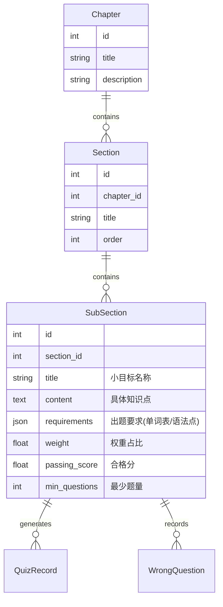

# 软件工程毕业设计开发文档 2.0 (目标导向版)

## 1. 系统概述 (System Overview)

本系统旨在构建一个**以目标为导向 (Goal-Oriented)** 的大学英语智慧学习平台。系统的核心逻辑从“内容堆砌”转变为“目标达成”。通过细化的三级教学目标（章-节-小目标），结合AI智能出题、个性化评分与可视化反馈，帮助学生精确掌握每个具体的知识点（单词、语法、应用）。

### 1.1 核心变更点
- **数据结构升级**：由扁平的章节结构升级为 **章(Chapter) - 节(Section) - 小目标(SubSection)** 三级结构。
- **出题逻辑重构**：不再随机出题，而是严格基于“小目标”定义的具体要求（如特定单词、特定语法）进行针对性出题。
- **评价体系重构**：引入权重评分制，每个小目标设定合格线与最少训练量。
- **用户界面重构**：全屏化沉浸式设计，大字体高清晰度，强调数据可视化对比。

---

## 2. 数据库设计 (Database Design)

### 2.1 实体关系图 (ERD) 变更

### 2.2 新增模型说明

#### 2.2.1 Section (小节)
- **作用**：逻辑分组，连接章节与具体目标。
- **关键字段**：`chapter_id`, `title`, `order`.

#### 2.2.2 SubSection (小目标)
- **作用**：教学的最小原子单位，也是出题和评估的基准。
- **关键字段**：
    - `requirements`: 存储JSON格式的结构化数据，例如 `{"words": ["apple", "banana"], "grammar": "present tense"}`，供AI读取生成题目。
    - `weight`: 该目标在章节中的分数占比（如20%）。
    - `passing_score`: 达标分数线（如80分）。
    - `min_questions`: 强制训练题量下限。

---

## 3. 核心功能模块 (Core Modules)

### 3.1 智能文档解析与目录生成
- **功能**：上传包含标记的Markdown/Word文档，自动解析出三级结构并入库。
- **解析逻辑**：
    - 识别 `[章节]`, `[节]`, `[小目标]` 锚点。
    - 提取小目标下的元数据（权重、合格分）和知识点内容。
    - 自动关联父子级关系。
- **实现服务**：`DocumentParsingService` (需更新)。

### 3.2 目标导向出题系统 (Goal-Oriented Quiz System)
系统根据不同类型的“小目标”调用不同的出题策略：

#### 策略 A：词汇掌握类 (小目标 1)
- **输入**：`requirements.words`
- **题型**：
    1. **看中写英**：给出中文释义 -> 输入英文单词。
    2. **看英写中**：给出英文单词 -> 输入/选择中文。
    3. **词性辨析**：选择单词在句中的正确词性形式。
    4. **听音选义**：调用TTS生成单词发音 -> 选择中文释义。

#### 策略 B：语法应用类 (小目标 2)
- **输入**：`requirements.grammar`
- **题型**：
    1. **强制语法翻译**：给出中文句子 -> 要求翻译成英文（AI校验是否使用了指定语法）。
    2. **语法选择题**：4个选项，考察特定语法的正确形式。

#### 策略 C：综合应用类 (小目标 3)
- **输入**：`requirements.words` + `requirements.grammar`
- **题型**：
    - **材料翻译**：生成一段包含目标词汇和语法的中文短文 -> 学生翻译 -> AI评分。

#### 策略 D：听说互动类 (小目标 4)
- **输入**：`requirements.dialogue_context`
- **流程**：
    1. AI生成一段符合语境的英文音频脚本。
    2. 调用 `TTSService` 生成音频文件。
    3. 学生听音频。
    4. 任务1：写下中文大意。
    5. 任务2：用英文进行书面回应（无口语输入，全文本交互）。

### 3.3 评分与评价系统
- **小目标得分**：`Score_subsection = (Correct / Total) * 100`
- **章节总分**：`Score_chapter = Σ (Score_subsection_i * Weight_i)`
- **难度分级出题 (Difficulty Grading)**：
    - 系统通过动态Prompt注入控制出题难度，确保练习适配学生水平：
    - **低难度 (Low)**：
        - 词汇范围：高中/简单四级 (High School / Basic CET-4)
        - 句式结构：简单句为主，避免复杂从句。
        - 适用场景：初学者或基础薄弱点强化。
    - **中难度 (Medium - 默认)**：
        - 词汇范围：**CET-4** 标准大纲词汇。
        - 句式结构：包含定语从句、状语从句等标准长难句。
        - 适用场景：日常章节练习。
    - **高难度 (High)**：
        - 词汇范围：**CET-6** / 雅思 (IELTS) 基础词汇。
        - 句式结构：复杂长难句，强调逻辑推理与深层理解。
        - 适用场景：高分挑战与进阶训练。
- **合格判定**：
    - 条件1：`Score_subsection >= passing_score`
    - 条件2：`Practice_count >= min_questions`
    - 结果：若任一条件未满足，前端显示“未达标”，并提示差距。

### 3.4 错题与推荐系统
- **错题库升级**：错题精确关联到 `SubSection`。
- **智能推荐**：
    - 分析逻辑：找到得分最低的 `SubSection`。
    - 推荐内容：该小目标对应的文档段落 + 针对该目标的专项强化练习题。
- **偏向性出题**：
    - 在生成练习时，优先检索错题库中属于当前小目标的错题。
    - 对于高频错词（如 "colleague" 拼写错误率高），在后续出题中提高其出现频率。

---

## 4. 前端界面重构 (Frontend Redesign)

### 4.1 总体设计风格
- **布局**：全屏 (`100vh`)，移除多余留白，最大化内容展示区。
- **排版**：字体字号整体调大（正文 16px -> 18px/20px），提高可读性。
- **配色**：高对比度，清晰区分“已掌握”（绿）、“未掌握”（红）、“进行中”（蓝）。

### 4.2 关键页面

#### 4.2.1 学生端 - 学习仪表盘
- **可视化图表 (Visualization)**：
    - **章节掌握度雷达图 (Chapter Mastery Radar)**：
        - 展示学生在各个章节的平均得分情况，直观反映优势与劣势章节。
        - 维度：各章节 (Chapter 1, Chapter 2...)
        - 指标：平均得分 (Average Score) vs 满分 (100)
    - **薄弱点分布柱状图 (Weak Points Bar Chart)**：
        - 展示学生的高频错误知识点。
        - X轴：错误次数。
        - Y轴：知识点名称。
- **进度树/列表**：
    - 章 -> 节 -> 小目标（折叠/展开）。
    - 每个小目标右侧显示：进度条、当前分数、是否达标标记。
    - **大字体/全屏模式**：支持一键切换全屏，配合大号字体，适合投影或专注查看。
- **训练入口**：点击任意“小目标”即可进入该目标的专项训练模式。

#### 4.2.2 教师端 - 班级学情
- **热力图/列表**：
    - 关注点：**小目标整体平均分** (Overall Average per SubSection)。
    - 不需要显示每个学生的具体小目标分数（避免信息过载）。
- **薄弱点预警**：自动列出全班平均分低于合格线的小目标，建议重点讲解。

#### 4.2.3 练习页面
- **布局**：左侧/上方为题目，右侧/下方为实时反馈。
- **听力题**：内置极简播放器，支持倍速播放。
- **结果页**：
    - 显示本次得分。
    - 详细解析（AI生成）。
    - 针对未掌握知识点的“再练一组”按钮。

---

## 5. 接口 API 规划 (API Roadmap)

### 5.1 章节管理
- `POST /api/v1/chapters/upload` : 上传文档并自动生成三级结构。
- `GET /api/v1/chapters/{id}/tree` : 获取章节-小节-小目标的完整树形结构。

### 5.2 练习生成
- `POST /api/v1/quiz/generate`
    - 参数：`subsection_id` (指定小目标), `mode` (targeted/review/weakness)。
    - 返回：根据小目标要求生成的题目列表。

### 5.3 学情分析
- `GET /api/v1/analysis/student/{id}/progress` : 获取学生在各小目标的完成度与得分。
- `GET /api/v1/analysis/class/weakpoints` : 获取班级共性薄弱小目标。

---

## 6. 开发计划 (Development Plan)

1.  **Phase 1: 基础架构 (已开始)**
    - [x] 数据库模型迁移 (Chapter/Section/SubSection)。
    - [ ] 修复数据库连接与初始化脚本。
    
2.  **Phase 2: 核心业务逻辑**
    - [ ] 实现文档解析器，支持新模板格式。
    - [ ] 编写针对四类小目标的出题Prompt和生成逻辑。
    - [ ] 实现TTS听力生成服务对接。

3.  **Phase 3: 接口与数据流**
    - [ ] 升级练习记录保存逻辑，关联 SubSection。
    - [ ] 实现加权评分算法。

4.  **Phase 4: 前端重构**
    - [ ] 搭建全屏布局框架。
    - [ ] 集成 ECharts 实现可视化图表。
    - [ ] 开发新的练习交互界面。
